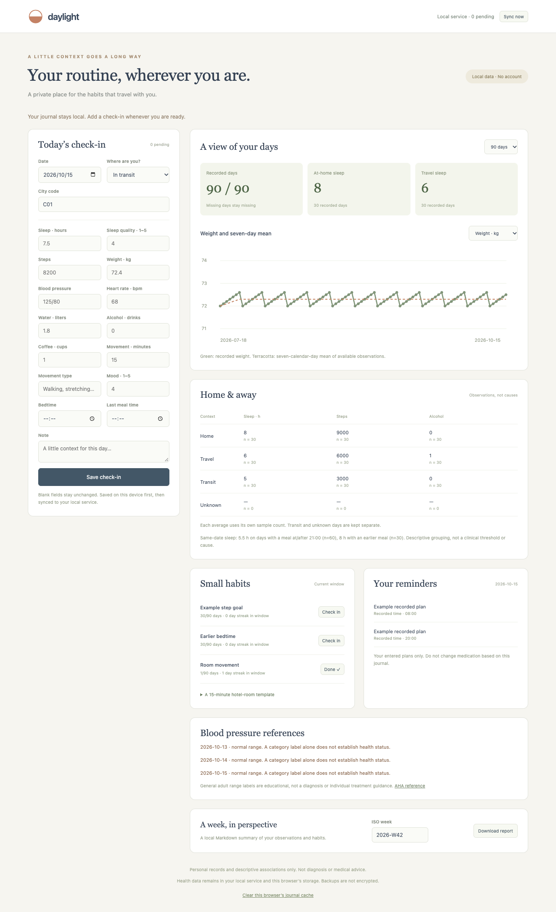

# Travel Health Log

An offline personal journal for people who travel: sleep, steps, weight, blood pressure, movement, habits, and recorded reminders, with home/trip/transit comparisons. The CLI, local FastAPI service, installable PWA, and five MCP tools share one SQLite core.

**Personal records and descriptive associations only. This software does not diagnose conditions, prescribe treatment, change medication plans, or establish that travel causes a health outcome.**



## Start in three commands

Python 3.11+ is required. From this repository:

```sh
python3 -m venv .venv && .venv/bin/python -m pip install -e '.[dev]'
THL_DATA_DIR=data/demo .venv/bin/python examples/seed_demo.py
.venv/bin/thl --data-dir data/demo serve
```

Open <http://127.0.0.1:8915>. The original fictional fixture contains 90 days ending October 15, 2026. For a reproducible historical comparison, run `thl --data-dir data/demo compare --days 90 --as-of 2026-10-15 --json`. The live dashboard follows the actual date. Repeated seeding does not duplicate measurements. Use another data directory for private records.

No account, API key, paid service, telemetry, CDN, wearable cloud access, or default network connection is needed. Install dependencies once; journal operations then remain local. On macOS environments that hide editable-install `.pth` files, use `chflags nohidden .venv/lib/python3.*/site-packages/*.pth`.

## Record and review

```sh
.venv/bin/thl log sleep=7.5 steps=9200 weight=72.4 bp=125/80 alcohol=0 --date 2026-10-15 --json
.venv/bin/thl day trip --city C01 --date 2026-10-15
.venv/bin/thl habit add "Example step goal" --metric steps --op gte --target 8000 --start 2026-10-01
.venv/bin/thl habit check "Example step goal" --date 2026-10-15
.venv/bin/thl stats --days 30 --as-of 2026-10-15 --json
.venv/bin/thl report --week 2026-W42 --out output/2026-W42.md
```

Measurements are daily values, not additive increments. Repeating the same date/metric/source replaces that value; omitted fields remain unchanged. Explicit check-ins override a habit's automatic rule for that date. Completion rates include eligible calendar days since habit creation; missing observations do not count as completed. Streaks end on the requested date and are bounded by the selected window. Bedtime comparisons treat 00:30 as later than 23:30. `thl templates` provides editable example goals and an optional 15-minute hotel-room movement template; these are examples, not prescriptions.

### Metric dictionary

| Key | Unit / input |
| --- | --- |
| `sleep`, `sleep_quality` | Hours, score 1–5 |
| `steps`, `weight` | Whole steps, kilograms |
| `bp` | `systolic/diastolic`; stored as two mmHg metrics |
| `systolic`, `diastolic`, `heart_rate` | mmHg, mmHg, beats/minute |
| `water`, `alcohol`, `coffee` | Liters, self-defined drinks, cups |
| `exercise`, `exercise_type` | Minutes, free-text activity label |
| `mood`, `meals` | Score 1–5, meal count |
| `bedtime`, `last_meal` | Local 24-hour `HH:MM` |

Use consistent drink/cup definitions; this journal does not infer ethanol or caffeine content. Numeric bounds reject malformed input, not determine individual health. Notes are optional. Unmarked day context is **unknown**, not home.

### Reminders

```sh
.venv/bin/thl med add "Example recorded plan" --schedule 08:00,20:00 --start 2026-10-01 --end 2026-10-20
.venv/bin/thl med taken "Example recorded plan" --date 2026-10-15 --time 08:00
.venv/bin/thl reminder add "Example follow-up" --date 2026-10-20
.venv/bin/thl due --as-of 2026-10-15 --at 09:00 --json
.venv/bin/thl reminder done 1
```

Medication labels and times are entered by the user. The tool never recommends a medicine or dose. `due` lists unrecorded scheduled times through `--at` (default 23:59 for the selected day), plus incomplete follow-ups due on or before that date. It does not silently mark missed doses, send push notifications, or tell a user to take an extra dose. An external agent can query reminders; sending a message requires separate user authorization.

## Offline PWA and sync contract

The browser saves each check-in in IndexedDB before attempting a network request. The service worker caches only the application shell. The browser keeps the last dashboard separately so it can show a clearly labeled cached summary offline. The queue survives reload and browser restart, subject to browser storage policies.

Each event has a random ID, creation timestamp, action, and payload. The server commits changes and the event receipt in one transaction. The browser deletes an event only after an explicit successful acknowledgement. A lost response is retried with the same ID, so it cannot duplicate the write. Reusing an ID for different content is rejected. Older metric edits are retained in event results without overwriting newer manual values; `ignored_stale` identifies them. Device clocks matter. Habit check-ins use last processed explicit completion, with event replay protection.

The actual browser acceptance test saved a check-in offline, reloaded while offline, restored connectivity, deliberately discarded the response **after the server committed**, then retried. One server event and two measurements remained; the queue returned to zero. See [docs/offline-sync-verification.json](docs/offline-sync-verification.json).

Use the browser's Install/Add to Home Screen command where supported. Service workers require a secure context: localhost works on the same device; a phone accessing a computer needs a trusted HTTPS local deployment. Plain HTTP over a LAN does not provide the offline PWA guarantee. Non-loopback binding requires `--allow-lan`; allow the exact hostname in configuration. There is no authentication, so restrict access to a trusted private environment. No tunnel or cloud service is created automatically.

**Server backups do not contain unsynced browser events.** Sync first and verify “0 pending” before clearing storage or changing browsers. The explicit browser-cache removal button also removes unsynced events after confirmation. Browser storage, SQLite, exports, and ZIP backups are not encrypted. Use operating-system encryption and appropriate device access controls for private health records.

## Imports, calendar handling, and source selection

```sh
.venv/bin/thl import examples/90-days.csv --json
.venv/bin/thl import apple-health examples/apple-health.xml --progress --json
.venv/bin/thl import trips examples/trips.csv --json
.venv/bin/thl export --format csv --kind entries --out output/entries.csv
.venv/bin/thl export --format json --out output/archive.json
.venv/bin/thl --data-dir data/restored import output/archive.json
.venv/bin/thl backup
```

Generic CSV accepts wide rows (`date,sleep,steps,...,status,city_code,note,source`) or long rows (`date,metric,value,unit,source,note`). JSON accepts the corresponding list or an `entries` list. Units must match the dictionary. Flat Apple-derived summaries are imported as a separate CSV source; they are not treated as raw Apple samples. Native CSV/JSON archives include every table, including raw samples, habits, check-ins, reminders, and sync receipts. Restore into an empty library; reimporting the identical archive is idempotent. CSV defaults to UTF-8 BOM; `--no-bom` selects plain UTF-8. Backups contain `health.db`, portable `archive.json`, and effective configuration.

Trip CSV accepts `start_at,end_at,destination`. It also reads trip entities directly from a native CSV export of [expense-claim-helper](https://github.com/GuoHaoyu1688/expense-claim-helper). Local departure/return dates become transit; intermediate dates become trip. Imported context updates existing day labels. Check results before relying on a comparison.

Apple Health XML is user-exported and parsed incrementally with entity/external-resource protections. No account is contacted. Supported types are step count, body mass, and asleep categories. In-bed and awake intervals are excluded, following [Apple's sleep-category definitions](https://developer.apple.com/documentation/healthkit/hkcategoryvaluesleepanalysis). Exact sample identities prevent repeat ingestion; a malformed supported sample rolls back the import. Original XML is not copied into the library.

- Steps crossing local midnight are allocated in proportion to elapsed time, with the remainder assigned to the final date. Overlapping nonidentical step intervals within one device are flagged for review; exact duplicates are removed.
- Sleep intervals are unioned per source. Intervals separated by at most 90 minutes form one session; gaps are not counted as sleep. The session belongs to its wake date. This is a documented journal convention, not an attempt to reproduce Apple's proprietary sleep summaries.
- Weight supports kg/lb; the latest measurement per source and local date is used.
- One source is selected per date/metric: manual first, then other imports, then configured preferred Apple source, otherwise the largest daily device value. Devices are never added together. Source names are returned with each selected value.
- Input offsets are respected, including daylight-saving transitions. The configured library calendar timezone is fixed after creation; use a separate library to analyze another timezone.

Only the supported subset is imported; workouts, ECG, locations, clinical records, medications, and other Apple types are ignored. Same-device overlapping step data may need cleaning before analysis. Large exports rebuild Apple daily aggregates; sleep-interval memory scales with the retained sleep subset. A reproducible 10,000-step XML benchmark is included in `examples/benchmark_import.py`; [local measurements](docs/import-benchmark.json) are evidence for that synthetic dataset only.

## Interpretation and public references

Home/trip/transit means include a count for each metric; missing values remain missing. The weight line shows a seven-calendar-day mean of available observations. Meal/sleep grouping uses a stated 21:00 split and same-date entries; it is neither a clinical cutoff nor evidence of causation. Reports use organizational suggestions such as consistent recording, not personalized treatment.

Blood-pressure hints use the American Heart Association's adult ranges: normal below 120/80; elevated systolic 120–129 with diastolic below 80; stage 1 systolic 130–139 or diastolic 80–89; stage 2 systolic at least 140 or diastolic at least 90. Values above 180 systolic or above 120 diastolic receive the severe-range reference and a prompt for professional assessment. Associated urgent symptoms receive an emergency-services message. These labels are not a diagnosis and do not cover pregnancy, children, or individual treatment targets. [AHA source, checked October 15, 2026](https://www.heart.org/en/health-topics/high-blood-pressure/blood-pressure-explained).

## Configuration and verification

`--data-dir` overrides `THL_DATA_DIR`, then defaults to `./data`. Configuration is read from `data/config.yaml` or `--config PATH`:

```yaml
timezone: Asia/Shanghai
private_permissions: true
preferred_apple_source: Example Watch
allowed_hosts: [127.0.0.1, localhost]
```

The data directory is restricted to mode 700 and SQLite/exports/backups to mode 600 by default. This is access control, not encryption. Keep data directories and browser profiles private. [AGENTS.md](AGENTS.md) documents every CLI command, exact MCP setup, error envelopes, idempotence, and recovery recipes.

```sh
.venv/bin/ruff check .
.venv/bin/ruff format --check .
.venv/bin/pytest --cov=travel_health_log --cov-report=term-missing
```

Tests cover 90-day expected means, official BP threshold boundaries, missing-data handling, inclusive calendar windows, display-independent rolling means, database overwrite protection, habit streaks, DST, XML protection, import rollback/idempotence, event replay/conflicts, archive roundtrips, all five MCP tools, actual stdio, and local HTTP. The browser acceptance additionally exercises real service-worker/IndexedDB offline behavior, lost-acknowledgement replay, and offline date rollover. [Validation evidence](docs/validation.json). GitHub Actions tests Python 3.11 and 3.12 on Ubuntu; local results do not imply remote CI has run.

## FAQ and roadmap

**Why do totals differ from a wearable app?** Device selection, midnight allocation, sleep-session rules, and imported scope are explicit journal conventions. The tool shows selected sources; it does not claim parity with Apple Health's device-priority algorithm.

**Can I remove private records?** Back up first. There is no destructive record-deletion command in this release. A separate data directory creates an empty journal. Browser cache removal is separate from server data; retain pending records until synced.

**Does the Web UI manage all schedules?** It provides quick metric entry, context, habit check-ins, charts, due items, and report downloads. Use CLI/MCP for the documented administrative actions. Reports require the local service to be available.

**Limitations:** one journal per data directory; daily metrics rather than continuous medical monitoring; no authentication, push delivery, encryption, medical diagnosis, cloud sync, or paid wearable integration. Phone installation depends on browser support and a secure local origin. Roadmap: export/review individual pending browser events, encrypted backup integration, and explicit source-priority configuration per metric. MIT licensed.
